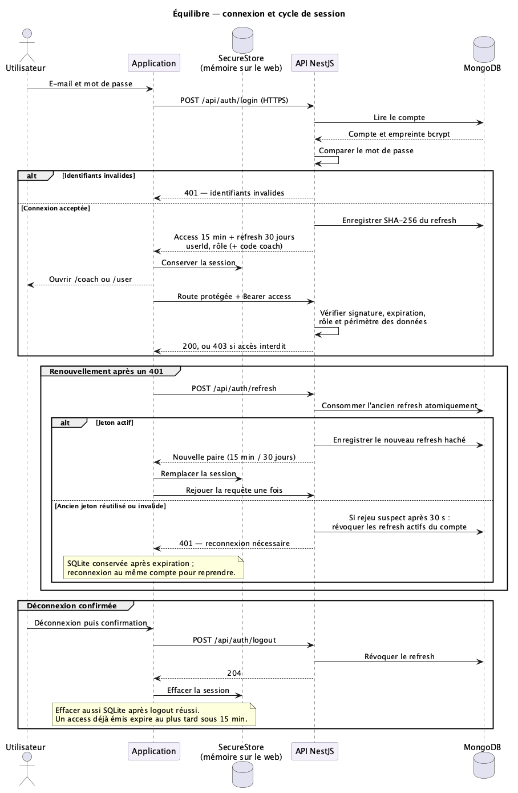

# Connexion, session et autorisations

Référence au 20 octobre 2026. Les contrats HTTP détaillés restent dans Swagger
(`/api/docs`) et [le guide API](../api/README.md).

## Parcours

1. `POST /api/auth/register` crée un compte avec prénom, nom, e-mail et mot de
   passe. Un utilisateur fournit le `coachCode` communiqué par son coach.
   `coachId` reste accepté pour compatibilité, mais pas avec `coachCode`.
2. `POST /api/auth/login` compare le mot de passe à son empreinte bcrypt.
   E-mail inconnu et mot de passe incorrect produisent le même refus HTTP 401.
3. L'API émet une paire de jetons et retourne `userId`, `role`, ainsi que
   `coachCode` pour un coach. Le mobile ouvre directement `/coach` ou `/user`.
4. Les appels protégés envoient `Authorization: Bearer <accessToken>`.
5. Après un HTTP 401, le client tente un renouvellement, puis rejoue la requête
   une seule fois s'il réussit. Les appels concurrents de `requestApi` partagent
   le même renouvellement.
6. La déconnexion révoque le refresh token, efface la session locale et, pour
   l'utilisateur, réinitialise la base embarquée après confirmation.

## Jetons et stockage

| Élément | Durée / stockage | Fonction |
|---|---|---|
| Mot de passe | Empreinte bcrypt dans MongoDB | Vérifier les identifiants ; jamais stocker le mot de passe en clair |
| Access token | 15 minutes | Authentifier les appels API |
| Refresh token | 30 jours à chaque émission | Renouveler la session sans ressaisir le mot de passe |
| Trace du refresh token | SHA-256 dans `refresh_tokens`, expiration et révocation | Retrouver et invalider un jeton sans le conserver en clair |
| Session iOS / Android | Expo SecureStore | Conserver les jetons sur le téléphone, séparément de SQLite |
| Session de la démo web | Mémoire uniquement | Un rechargement complet déconnecte ; pas de localStorage ni sessionStorage |

Les JWT sont signés, pas chiffrés : leur contenu peut être décodé. Le payload
applicatif est minimal (`sub`, `role`), avec un `jti` unique pour le refresh token
et les dates JWT `iat` / `exp`. Aucune donnée alimentaire ni mot de passe n'y figure.
`JWT_SECRET` et `JWT_REFRESH_SECRET` sont distincts et validés au démarrage
(32 caractères minimum). Leur séparation ne dispense pas de traiter une fuite
de secret comme un incident de sécurité.

La session est **glissante** : chaque renouvellement émet un nouveau refresh
valable 30 jours. Ce n'est pas une expiration fixe 30 jours après le premier login.
MongoDB purge les traces expirées via un index TTL ; l'API vérifie aussi l'expiration,
sans attendre le passage du nettoyage TTL.

## Rotation et réutilisation

L'API vérifie le JWT de refresh, puis consomme son enregistrement par une mise
à jour MongoDB atomique (`revoked: false`, expiration future). Une seule de deux
rotations simultanées peut réussir. Le nouveau refresh est enregistré haché.

Un ancien refresh est toujours refusé :

- réutilisé dans les 30 secondes suivant sa révocation : HTTP 401 simple ;
- réutilisé après 30 secondes, tant qu'il n'est pas expiré : HTTP 401 et révocation
  de tous les refresh tokens actifs du compte (réutilisation suspecte).

La fenêtre de 30 secondes ne rend donc pas l'ancien jeton réutilisable.

### Limite : réponse de renouvellement perdue

Si le serveur valide une rotation mais que sa réponse est perdue, le téléphone
ne connaît pas le nouveau refresh. La prochaine tentative avec l'ancien reçoit
401 ; après 30 secondes, elle peut également révoquer les autres sessions.
Une reconnexion avec le mot de passe est alors nécessaire. Le test d'intégration
reproduit l'état serveur en ignorant la réponse réussie, puis en rejouant l'ancien
jeton immédiatement et après le délai ; il ne simule pas une panne radio réelle.

Le mobile conserve la session sur une erreur réseau et la retire après un refus
401 de refresh. Cette expiration n'efface pas SQLite : les saisies en attente
restent disponibles pour une reconnexion avec le même compte. Une déconnexion
volontaire confirmée, ou le passage à un autre compte, efface en revanche ces données.
Une reprise transparente après une réponse perdue demanderait un protocole distinct
à concevoir et à tester ; elle n'est pas garantie par la rotation actuelle.

## Authentification et autorisations

| Contrôle | Résultat |
|---|---|
| JWT absent, falsifié ou expiré (`JwtAuthGuard`) | 401 |
| Rôle interdit (`RolesGuard` et `@Roles`) | 403 |
| Coach ciblant un utilisateur non rattaché | 403 dans les cas d'usage concernés |
| Utilisateur connecté | Accès limité à ses propres données |

La redirection mobile améliore la navigation ; la protection effective est dans
l'API. L'identité provient du JWT vérifié, jamais d'un identifiant utilisateur
arbitraire fourni par le client pour les routes personnelles.

## Hors ligne et déconnexion

La première connexion nécessite Internet. Au démarrage hors ligne, le mobile
peut reprendre une session déjà enregistrée pour consulter SQLite ; cela ne
valide pas un jeton auprès du serveur et ne donne aucun accès API hors ligne.
Le rôle coach reste un parcours en ligne.

Le bouton Déconnexion tente une dernière synchronisation puis affiche une fenêtre
de confirmation. Elle indique combien de modifications seraient perdues. Après
confirmation, le refresh est révoqué et la session effacée. Une panne réseau au
logout conserve la session afin de pouvoir réessayer.

**Limite de révocation :** un access token déjà émis reste valable jusqu'à son
expiration (au maximum 15 minutes). Le logout interdit son renouvellement ; il
ne constitue pas une révocation immédiate de tous les access tokens.

## Limitation des requêtes derrière Caddy

Le limiteur applique 100 requêtes/minute **par route et par IP**, avec une limite
spécifique de 5 requêtes/minute pour le login. Un HTTP 429 comprend `Retry-After`.
Les compteurs sont en mémoire de chaque instance API ; ils ne sont pas partagés
entre plusieurs réplicas et repartent à zéro au redémarrage.

Sur OVH, `TRUSTED_PROXY_IPS` contient les IP exactes des proxys administrés, sur
le réseau Docker de l'API. Express ne prend `X-Forwarded-For` en compte que depuis
ces IP et s'arrête à la première adresse non fiable en remontant la chaîne.
Une valeur vide signifie accès direct : aucun en-tête de proxy n'est cru.
Les valeurs `true`, les nombres de sauts, les noms DNS et les plages CIDR sont refusés.
Après recréation de Caddy, vérifier son IP et actualiser la configuration avant
de recréer l'API. Ne pas recopier une IP d'exemple sans vérifier la cible.

## Diagramme et preuves



Source : [sequence-authentification.puml](diagrammes/sequence-authentification.puml).

| Vérification | Preuve automatisée |
|---|---|
| Login, mot de passe incorrect, inscription concurrente | `api/test/auth.integration-spec.ts` |
| Rotation, rejeu, session glissante, réponse perdue, logout | même suite, MongoDB réel et vérification des documents |
| Deux IP derrière un proxy, en-têtes forgés, accès direct | `api/test/auth-proxy.integration-spec.ts` |
| Renouvellement partagé, panne réseau puis 401 | `mobile/tests/plan-api.test.ts` |
| Conservation du fichier SQLite et de l'outbox | `mobile/src/sync/tests/local-store.test.ts` |

Depuis la racine, avec MongoDB de test démarré :

```bash
pnpm --dir api test:e2e:local --runInBand auth.integration-spec.ts auth-proxy.integration-spec.ts
pnpm --dir mobile test --runTestsByPath tests/plan-api.test.ts
```

Les tests HTTP utilisent Nest et MongoDB réels ; les tests mobiles isolent le
transport réseau. Ils ne remplacent pas une recette sur téléphone.

Références : [NestJS, limiteur derrière un proxy](https://docs.nestjs.com/security/rate-limiting),
[Express, proxys de confiance](https://expressjs.com/en/guide/behind-proxies/).
